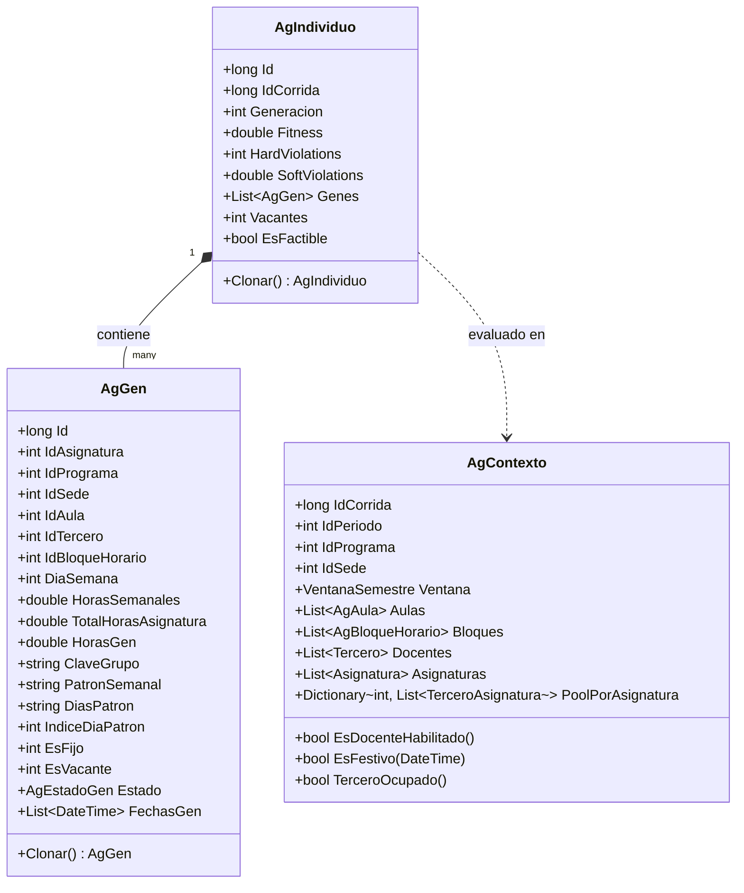
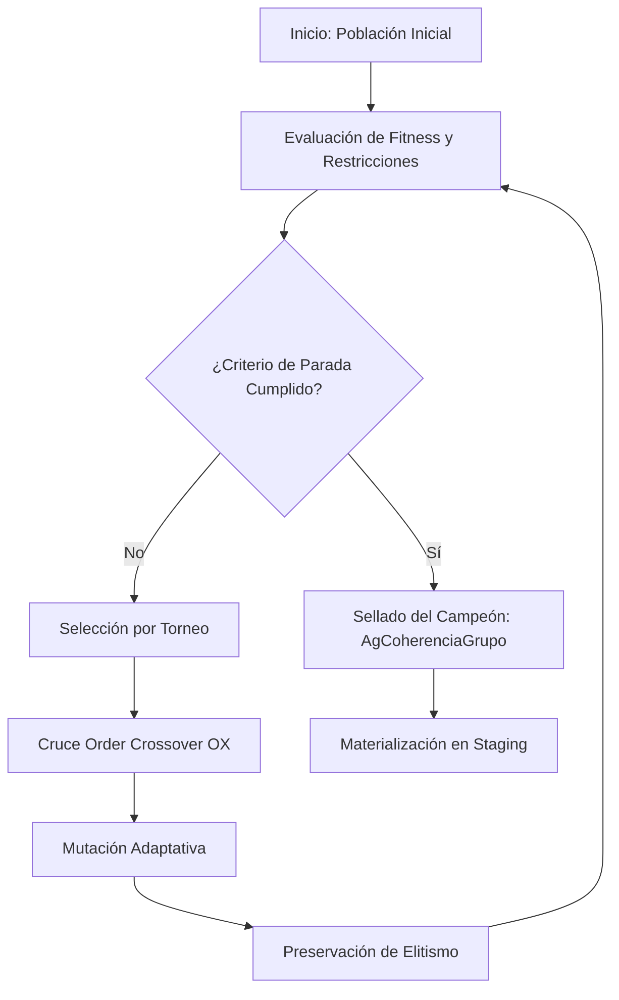
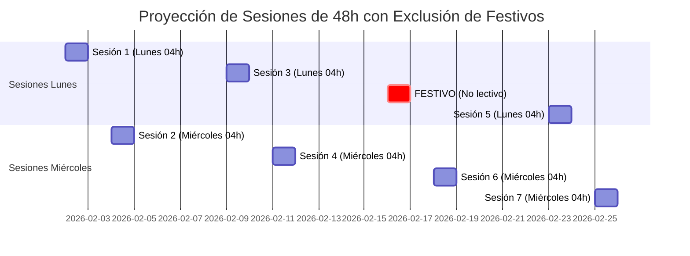
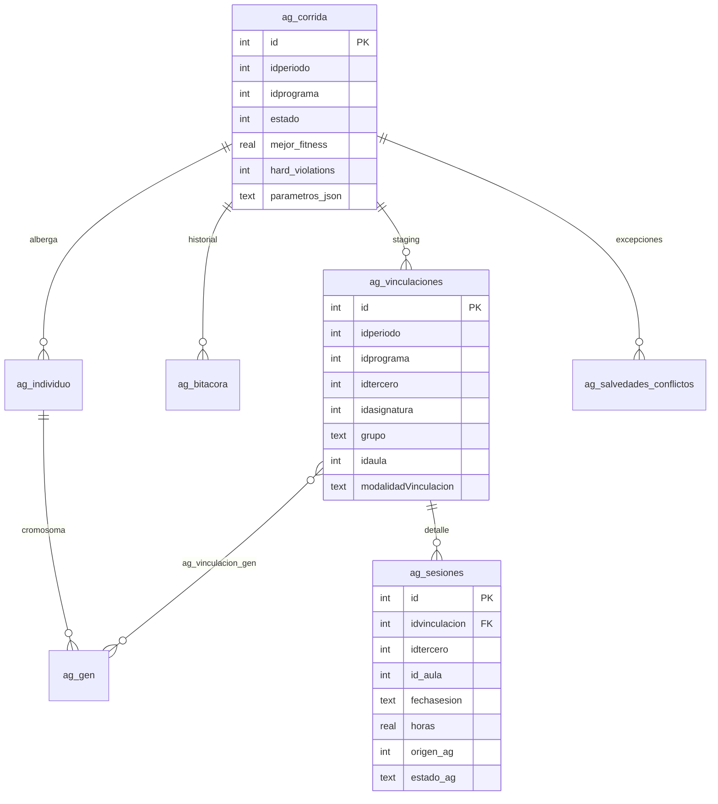

# Plan de Diseño Consolidado: Motor de Optimización de Horarios Académicos mediante Algoritmos Genéticos (AG)

**Sistema:** ConversorPDF (Módulo Académico)  
**Tecnología:** .NET Framework 4.8 / Excel-DNA / SQLite & CR-SQLite / WinForms  
**Patrón Arquitectónico:** Modular Monolith con Vertical Slice Architecture  
**Versión de Referencia:** 1.6.3.42  
**Clasificación:** Documentación Técnica de Ingeniería y Arquitectura de Software  

---

## 1. Introducción y Contexto de Negocio

### 1.1 Naturaleza del Problema
La programación de horarios académicos universitarios representa una instancia de alta complejidad computacional correspondiente a la familia de problemas de optimización combinatoria **NP-Hard** (generalización del *Job-Shop Scheduling Problem* y *Timetabling Problem* multidimensional). En la Escuela Superior de Administración Pública (ESAP), el problema presenta particularidades críticas:

1. **Restricciones de Desplazamiento y Viáticos:** Gran parte del cuerpo docente no reside en la sede de impartición, requiriendo desplazamientos intermunicipales, pago de viáticos y acomodación temporal. Un horario ineficiente multiplica los costos de viáticos institucionales.
2. **Ventana Temporal Acotada ($\alpha$):** Los semestres académicos operan sobre ventanas estrictas de fechas (ej. calendario presencial regular o modular concentrado). Ninguna sesión puede programarse fuera de los límites de inicio y fin semestral.
3. **Multi-Sede y Multi-Cohorte:** La programación involucra múltiples sedes territoriales simultáneas con oferta modular, compartición de espacios físicos, pool de docentes habilitados por asignaturas y franjas horarias específicas.
4. **Preservación de Asignaciones Previas:** Existencia de asignaciones fijadas manualmente o por requerimiento directivo que actúan como invariantes inmutables en el proceso de optimización.

### 1.2 Objetivos del Sistema
El motor de **Algoritmos Genéticos (AG)** implementado automatiza la búsqueda de soluciones óptimas o cuasi-óptimas que satisfacen el 100% de las restricciones operativas institucionales (**Hard Constraints**) mientras maximizan la satisfacción de preferencias docentes, minimizan desplazamientos/costos y aseguran una distribución pedagógica uniforme (**Soft Constraints**).

### 1.3 Límites Físicos y Arquitectura
El sistema se encuentra desacoplado físicamente bajo la **Vertical Slice Architecture** en `ConversorPDF.XLL/Academic`:
- **Domain Layer (`Academic/Domain`):** Pureza lógica C# sin dependencias de infraestructura ni Office Interop. Define entidades del genoma (`AgGen`, `AgIndividuo`), modelos de contexto (`AgContexto`), excepciones de dominio y contratos (`IAg*Repository`).
- **Application Layer (`Academic/Application`):** Servicios de orquestación (`AgGeneradorHorarios`), validadores de reglas (`AgValidadorReglas`), evaluador de función objetivo (`AgEvaluadorAptitud`), operadores genéticos (`AgOperadorCruce`, `AgOperadorMutacion`, `AgOperadorSeleccion`), y mappers desacoplados.
- **Infrastructure Layer (`Academic/Infrastructure`):** Repositorios Dapper/SQLite, migraciones de esquema, loaders de librerías nativas y exportadores.
- **UI Layer (`Academic/UI`):** Formularios WinForms desacoplados (`AgFormGeneradorHorarios`) coordinados a través del Ribbon.

---

## 2. Modelo del Dominio y Estructura del Genoma

El motor modela la planificación horaria mediante un enfoque genético discreto y determinista:



### 2.1 Entidad Genómica Atómica (`AgGen`)
Un gen representa la asignación indivisible de una porción de carga horaria (un bloque de día semanal) a una unidad curricular específica:
- **Identidad y Contexto:** `IdAsignatura`, `IdPrograma`, `IdSede`, `Semestre`, `Grupo`.
- **Recursos Asignados:** `IdAula` (aula física), `IdTercero` (docente asignado del pool), `IdBloqueHorario` (franja temporal).
- **Atributos Temporales:** `DiaSemana` (1=Lunes .. 7=Domingo), `HorasSemanales` (duración del bloque, por norma 4.0 h), `HorasGen` (carga efectiva aportada por este gen).
- **Agrupamiento Determinista (`ClaveGrupo`):** Cadena de formato `{IdAsignatura}|{IdAula}|{Grupo}` que vincula todos los genes pertenecientes a la misma asignatura y grupo de estudiantes.
- **Patrón Multidía:** `PatronSemanal` (histograma de sesiones semanales), `DiasPatron` (lista serializada de días ISO ej. `"1,3"` para Lunes y Miércoles), `IndiceDiaPatron` (índice 0-based del día en el patrón).
- **Inmutabilidad y Vacantes:** `EsFijo` (1 = gen preexistente inmutable), `EsVacante` (1 = asignatura sin docente elegible disponible en el pool), `MotivoVacante`.
- **Fechas Concretas (`FechasGen`):** Colección de instancias `DateTime` válidas proyectadas por el planificador semanal para este gen, descartando días festivos.

### 2.2 Cromosoma (`AgIndividuo`)
El cromosoma representa una solución tentativa global para todas las cohortes y asignaturas seleccionadas:
- Contiene la colección completa `List<AgGen> Genes`.
- Almacena su evaluación: `Fitness` (escalar continuo), `HardViolations` (entero), `SoftViolations` (penalización acumulada continua).
- Propiedad de Factibilidad: `EsFactible => HardViolations == 0`. Una solución con cualquier penalidad dura se considera no apta para promoción operativa.

### 2.3 Contexto de Optimización (`AgContexto`)
Estructura inmutable durante la evolución que indexa en memoria $O(1)$ los catálogos y restricciones:
- Índices de consulta rápida: `AulasPorId`, `BloquesPorId`, `AsignaturasPorId`, `DocentesPorId`.
- Matriz de Compatibilidad: `PoolDocenteKeys` (HashSet con claves hash compuestas `(IdTercero, IdPrograma, IdAsignatura, Semestre)`).
- Calendario Oficial: Colección `Festivos` y función `EsFestivo(DateTime)` para evaluar festividades nacionales.
- Ocupaciones Externas: `OcupacionExterna` registra compromisos de docentes en otras facultades/sedes para evitar sobreasignación interinstitucional.

---

## 3. Formulación Matemática y Función de Aptitud (Fitness)

### 3.1 Función Objetivo Multitérmino
La evaluación de aptitud de un individuo $I$ se formaliza mediante una función escalar multiobjetivo con ponderación de incentivos y penalizaciones:

$$\mathcal{F}(I) = w_1 F_1(I) - F_2(I) + w_3 F_3(I) + w_4 F_4(I) + w_5 F_5(I)$$

Donde los hiperparámetros por defecto en `AgPesosFitness` establecen:
$w_1 = 1.0, \quad w_3 = 2.0, \quad w_4 = 1.0, \quad w_5 = 2.0$

#### Componentes de la Aptitud:
1. **Cobertura Básica ($F_1$):**
   $$F_1(I) = \sum_{g \in I} \mathbb{I}(\text{Estado}(g) \neq \text{Invalido})$$
   Recompensa la proporción de genes válidamente configurados en el individuo.

2. **Término de Penalización ($F_2$):**
   $$F_2(I) = \text{HardViolations}(I) \times K_{\text{hard}} + \text{SoftViolations}(I)$$
   Donde $K_{\text{hard}} = 1000.0$ es una penalización de barrera estricta que subordina cualquier ganancia en restricciones blandas a la satisfacción de las restricciones duras.

3. **Incentivo de Ventana Temporal ($F_3$):**
   $$F_3(I) = \sum_{g \in I} \mathbb{I}(g \subseteq [\text{Inicio}_{\text{semestre}}, \text{Fin}_{\text{semestre}}])$$
   Bonifica cada gen cuyas fechas proyectadas residen estrictamente dentro de la ventana del calendario académico $\alpha$.

4. **Afinidad Residencial y Minimización de Viáticos ($F_4$):**
   $$F_4(I) = \sum_{g \in I} \mathbb{I}(\text{CiudadResidencia}(\text{Docente}(g)) = \text{CiudadSede}(g))$$
   Maximiza la asignación de docentes locales de la sede, minimizando traslados innecesarios y presupuesto de viáticos.

5. **Preservación de Invariantes Fijas ($F_5$):**
   $$F_5(I) = \sum_{g \in I} \mathbb{I}(\text{EsFijo}(g) = 1 \land \text{CoincideConOriginal}(g))$$
   Garantiza que la evolución no degrade ni altere los cursos fijados previamente por coordinación académica.

### 3.2 Invariantes Fundamentales de Dominio

#### Invariante 1 (I1) — Cobertura Exacta de Carga Horaria:
Para todo grupo curricular $G_k$ identificado unívocamente por su clave compuesta `ClaveGrupo`:
$$\sum_{g \in G_k} \text{HorasGen}(g) = \text{TotalHorasAsignatura}(G_k)$$
Ningún grupo puede graduar más ni menos horas lectivas que las estipuladas en el plan de estudios.

#### Invariante 2 (I2) — Cuantización Modular de Bloques (4.0 Horas):
Toda sesión lectiva elemental y gen opera en bloques múltiplos de 4 horas:
$$\text{HorasGen}(g) = 4.0 \cdot k, \quad k \in \mathbb{N}_{\ge 0}$$
En caso de asignaturas con intensidades curriculares atípicas (ej. 45, 60, 68 horas), el sistema aplica normalización defensiva al inicializar la fábrica:
$$\text{TotalHoras} \leftarrow \left\lceil \frac{\text{TotalHoras}}{4.0} \right\rceil \times 4.0$$
Preservando la sincronización exacta con los bloques físicos de aula sin generar residuos fraccionarios inmanejables.

---

## 4. Catálogo de Restricciones y Reglas de Validación

El validador de reglas (`AgValidadorReglas`) inspecciona cada cromosoma registrando infracciones en `AgViolacion`:

| Código | Tipo | Regla | Formulación / Condición | Consecuencia |
| :--- | :---: | :--- | :--- | :--- |
| **R1** | Hard | Superposición de Docente | $\text{Docente}(g_a) = \text{Docente}(g_b) \land \text{Bloque}(g_a) = \text{Bloque}(g_b)$ con solapamiento temporal. | Bloquea factibilidad ($+1$ Hard) |
| **R2** | Hard | Superposición de Aula | $\text{Aula}(g_a) = \text{Aula}(g_b) \land \text{Bloque}(g_a) = \text{Bloque}(g_b)$ en misma fecha. | Bloquea factibilidad ($+1$ Hard) |
| **R3** | Hard | Superposición de Grupo | Grupo estudiantil idéntico con clases simultáneas en franjas solapadas. | Bloquea factibilidad ($+1$ Hard) |
| **R4** | Hard | Compatibilidad de Aula | Aula no disponible o con capacidad menor a la cohorte esperada. | Bloquea factibilidad ($+1$ Hard) |
| **R5** | Hard | Habilitación en Pool | Docente no registrado en `terceros_asignaturas` para la materia/semestre. | Bloquea factibilidad ($+1$ Hard) |
| **R6** | Hard | Consistencia Horaria (I1) | Suma de horas del grupo $\neq$ Horas totales de asignatura. | Bloquea factibilidad ($+1$ Hard) |
| **R7** | Hard | Ocupación Externa | Docente comprometido en franja idéntica en otra facultad/subunidad. | Bloquea factibilidad ($+1$ Hard) |
| **W1** | Hard | Ventana Semestral $\alpha$ | Sesión con fecha proyectada fuera de $[F_{\text{inicio}}, F_{\text{fin}}]$. | Bloquea factibilidad ($+1$ Hard) |
| **S1** | Soft | Preferencia Horaria | Bloque asignado en día/franja desfavorecida por el docente. | $+10.0$ SoftViolations |
| **S2** | Soft | Desplazamiento Inter-Sede | Docente dictando en dos sedes físicas diferentes el mismo día. | $+50.0$ SoftViolations |
| **S3** | Soft | Huecos Horarios (Ventanas) | Espacios muertos mayores a 4 horas entre clases continuas del docente. | $+15.0$ SoftViolations |
| **S4** | Soft | Distribución Semanal | Asignaturas concentradas en días consecutivos sin espaciamiento pedagógico. | $+20.0$ SoftViolations |
| **S5** | Soft | Balance de Carga | Docente asignado por encima de su capacidad semanal contratada. | $+30.0$ SoftViolations |

### 4.1 Validador de Pre-Vuelo (`AgValidadorVentana`)
Antes de instanciar la población inicial, el sistema ejecuta una validación determinista de capacidad real:
1. Extrae los días hábiles del patrón temporal (`LUNES-MIERCOLES`, `VIERNES-SABADO`, etc.).
2. Cuenta las ocurrencias reales libres de festivos dentro del intervalo $[F_{\text{inicio}}, F_{\text{fin}}]$.
3. Verifica la capacidad física:
   $$\text{CapacidadSemanas} = \text{ContarOcurrencias}(\text{DiaSemana}, \text{FechaInicio}, \text{FechaFin}, \text{EsFestivo})$$
   $$\text{CapacidadHoras} = \text{CapacidadSemanas} \times 4.0$$
4. Si $\text{CapacidadHoras} < \text{TotalHorasAsignatura}$ en todas las aulas disponibles, el pre-vuelo aborta la corrida anticipadamente con un `InformeFactibilidad` descriptivo, impidiendo el gasto computacional de una optimización matemáticamente imposible.

---

## 5. Operadores Genéticos y Dinámica Evolutiva

### 5.1 Ciclo Evolutivo
El motor orquesta la evolución de la población siguiendo un modelo generacional con reemplazo y elitismo:



### 5.2 Selección por Torneo (`AgOperadorSeleccion`)
- Se extrae una muestra aleatoria de tamaño $k = 3$ individuos.
- El individuo con mayor aptitud $\mathcal{F}$ gana el torneo y pasa al pool reproductivo.
- Este esquema garantiza una presión de selección calibrada que previene la convergencia prematura en óptimos locales sin degradar la diversidad genética.

### 5.3 Cruce por Permutación de Orden (`AgOperadorCruce` - OX Adaptativo)
El cruce toma dos individuos progenitores ($P_1, P_2$) y genera dos descendientes ($H_1, H_2$) respetando las restricciones estructurales:
1. **Preservación Inmutable:** Los genes con `EsFijo == 1` se heredan directamente en su posición exacta y son inmunes al operador.
2. **Segmentación:** Se eligen dos puntos de corte pseudoaleatorios $[p_1, p_2]$. El segmento central de $P_1$ se trasplanta directamente a $H_1$.
3. **Filtro de Semestre y Habilitación:** Antes de transferir un gen desde el donante, se verifica que la asignatura pertenezca al semestre compatible del aula receptora (`AgFormatoAsignatura.SemestreRomano`).
4. **Rescate en Cascada de Bloques:** Si el gen transferido no cuenta con un bloque horario asignable en el día objetivo, el operador ejecuta búsqueda de bloques activos en el patrón (`AgPlanificadorPatronSemanal.DiasKDe`), asignando una franja válida y marcando preventivamente el gen como `AgEstadoGen.Incompleto` si requiere reparación posterior.
5. **Deduplicación en Bucle Caliente:** Las advertencias de cruce se controlan mediante `LoggerHelper.WarningLimitado($"CruceSinBloque|{IdCorrida}|{Dia}", ..., maxVeces: 1)` evitando la inundación del buffer de logging.

### 5.4 Mutación Adaptativa (`AgOperadorMutacion`)
Afecta a los descendientes con una probabilidad de mutación $P_m = 0.10$:
- **Mutación de Docente:** Explora candidatos alternos habilitados en `PoolPorAsignatura` con prioridad para docentes locales residentes en la sede.
- **Mutación de Bloque Horario:** Intercambia el bloque horario actual por otra franja activa dentro de los días permitidos por el patrón semanal.
- **Mutación de Aula:** Reasigna el gen a otra aula compatible de la cohorte disponible.
- **Protección de Genes Fijados:** Todo gen con `EsFijo == 1` rechaza incondicionalmente cualquier mutación.

### 5.5 Algoritmo de Coherencia de Grupo y Sellado (`AgCoherenciaGrupo.Sellar`)
Antes de consolidar el mejor individuo de la corrida (*Campeón*), el motor ejecuta un procedimiento de sellado y armonización para garantizar que los genes de una misma asignatura/grupo no queden fragmentados:
1. **Unificación Docente:** Determina el docente más frecuente asignado al grupo (moda estadística de `IdTercero`). Si existen genes fijados, el docente fijado prevalece obligatoriamente sobre los demás.
2. **Consolidación de Vacantes:** Si el grupo no tiene docentes habilitados en el pool, todos los genes del grupo se marcan unificadamente con `EsVacante = 1` y motivo descriptivo.
3. **Ajuste de Invariante I1 (Balance de Horas):**
   $$\Delta = \text{TotalHorasAsignatura} - \sum \text{HorasGen}$$
   - Si $\Delta > 0$ (déficit): El residuo se distribuye entre los genes con menor carga, respetando bloques de 4 h.
   - Si $\Delta < 0$ (superávit): Se reducen horas de los genes de menor prioridad o se apagan genes sobrantes fijando `HorasGen = 0.0`.
   - Los genes con `HorasGen == 0.0` se preservan estructuralmente en el cromosoma para no alterar los índices fijos de cruce pero son ignorados durante la materialización física.

---

## 6. Planificación Temporal y Proyección de Sesiones

### 6.1 Descomposición del Patrón Semanal (`AgPlanificadorTemporal`)
Las asignaturas se dictan con arreglo a patrones semanales definidos en el catálogo:

```
Patrón: LUNES-MIERCOLES (2 días/sem) -> Bloque 4h x día -> 8h/semana
Total Asignatura: 48h -> 12 sesiones (6 semanas de calendario)
```



### 6.2 Manejo de Festividades Nacionales
El algoritmo de proyección temporal avanza semana a semana a partir de la fecha de inicio:
```csharp
DateTime cursor = fechaInicio.Date;
while (horasAcumuladas < totalHoras && cursor <= fechaFin.Date)
{
    if (cursor.DayOfWeek == diaSemanaDeseado && !contexto.EsFestivo(cursor))
    {
        fechas.Add(cursor);
        horasAcumuladas += 4.0;
    }
    cursor = cursor.AddDays(1);
}
```
Si una sesión coincide con un festivo oficial, el cursor la omite y avanza a la siguiente semana disponible, garantizando que el estudiante y docente cumplan las horas de clase contratadas sin sesiones ficticias en días feriados.

---

## 7. Arquitectura de Persistencia, Staging y Promoción

### 7.1 Modelo Físico de Staging
Para salvaguardar la integridad de la base de datos de producción ante errores de convergencia, el sistema opera bajo un patrón de aislamiento denominado **Staging Inmutable**:



### 7.2 Aislamiento de Errores: Cuarentena por Grupo (`AgMaterializadorSesiones`)
Durante el paso del individuo óptimo hacia las tablas `ag_vinculaciones` y `ag_sesiones`, se realiza una verificación final de las Invariantes I1 e I2.
- **Enfoque Clásico:** Una sola discrepancia en una materia causaba `StagingVacio` y abortaba la corrida entera.
- **Enfoque de Cuarentena (Fase 584):** Si un grupo presenta inconsistencia (ej. $96\text{ h}$ proyectadas vs $48\text{ h}$ requeridas), **únicamente dicho grupo** se aísla en cuarentena y se reporta en el log. Los demás grupos conformes se materializan exitosamente en staging:
  ```csharp
  // Advertencia estructurada con composición exacta
  LoggerHelper.WarningLimitado(
      $"CuarentenaI1|{idCorrida}|{claveGrupo}",
      $"[Materializador] grupo en cuarentena (I1): clave='{claveGrupo}' genes={genes.Count} esperado={esperado} Σ={suma} [...]",
      maxVeces: 1);
  ```

### 7.3 Promoción No Destructiva a Producción (`AgPromotorVinculaciones`)
Una vez el coordinador académico revisa los horarios generados en la interfaz gráfica:
1. Se inicia una transacción SQLite en el contexto encriptado `EncryptedSQLiteContext`.
2. Las cabeceras `ag_vinculaciones` se migran a la tabla definitiva `vinculaciones` resolviendo números de contrato y claves foráneas de producción.
3. Las sesiones `ag_sesiones` se copian a la tabla oficial `sesiones` vinculándolas con la nueva cabecera generada.
4. Se registra la bitácora de promoción en `ag_promocion`.
5. Si ocurre cualquier excepción en el proceso COM o de base de datos, la transacción ejecuta un `ROLLBACK` total, garantizando que el catálogo operativo nunca quede en estado corrupto o inconsistente.

---

## 8. Telemetría, Logging y Diagnóstico del Pipeline

### 8.1 Sistema Centralizado de Registro (`LoggerHelper`)
El motor implementa un pipeline de logging desacoplado con cola concurrente en segundo plano (`ConcurrentQueue<LogMessage>`) que no bloquea el hilo de cálculo genético STA:
- **Niveles de Severidad:** `Debug`, `Info`, `Success`, `Warn`, `Error`, `Ninguno`.
- **Modo Verboso:** La traza detallada y volcados de *StackTrace* se inhiben en entornos de producción, activándose únicamente bajo diagnóstico técnico explícito (`LoggerHelper.ModoVerboso = true`).
- **Deduplicación Centralizada:** Métodos `WarningLimitado(clave, mensaje, maxVeces)` y `ReiniciarDedupe()` que previenen la re-inundación del buffer de log ante bucles iterativos intensivos.

### 8.2 Trazabilidad de Corridas (`AgDiagnosticoTraza`)
Cada ejecución instancia una sesión de trazabilidad correlacionada (`Ag:{Correlacion}`):
- Emite unívocamente una línea de inicio `=== INICIO ===` y una de cierre `=== FIN ===`.
- Agrega contadores de operaciones internas (`_conteos`), reportando métricas de éxito en una sola línea de resumen:
  ```
  [2026-10-14 14:50:00] [RESUMEN] [InicioCorridaAG] Periodo=2027-1 | Programa=AP | Sede=VALLE | Cohortes=14 | Poblacion=50 | Generaciones=200
  [2026-10-14 14:50:20] [RESUMEN] [FinCorridaAG] IdCorrida=12 | Estado=Completada | Fitness=0.9850 | Hard=0 | Vinculaciones=28 | Sesiones=336 | Horas=1344.0
  ```

---

## 9. Guía de Operación y Catálogo de Hiperparámetros

### 9.1 Hiperparámetros Recomendados

| Hiperparámetro | Valor Estándar | Rango Típico | Impacto en el Comportamiento |
| :--- | :---: | :---: | :--- |
| **Tamaño de Población** (`PoblacionTamano`) | `50` | `30 - 100` | Mayor valor aumenta la diversidad exploratoria pero eleva el consumo de CPU. |
| **Generaciones Máximas** (`GeneracionesMax`) | `200` | `100 - 500` | Límite superior de iteraciones del bucle generacional. |
| **Tasa de Cruce** (`TasaCruce`) | `0.85` | `0.70 - 0.95` | Probabilidad de recombinación por orden (OX) entre parejas de individuos. |
| **Tasa de Mutación** (`TasaMutacion`) | `0.10` | `0.05 - 0.20` | Frecuencia de perturbación de docentes, bloques o aulas. |
| **Elitismo** (`Elitismo`) | `2` | `1 - 5` | Cantidad de mejores individuos copiados intactos a la siguiente generación. |
| **Tamaño de Torneo** (`TorneoTamano`) | `3` | `2 - 5` | Presión selectiva en el operador de selección. |
| **Penalización Hard** (`PenalidadHardBase`) | `1000.0` | `500.0 - 5000.0` | Ponderación que convierte en inviable cualquier individuo con conflictos. |

### 9.2 Criterios de Aceptación para Despliegues y Pruebas de Humo (Smoke Tests)
Para certificar que una corrida en una sede masiva (ej. **VALLE 2027-01** con 14 cohortes) es válida:
1. **Factibilidad Estricta:** `HardViolations == 0` en el individuo campeón.
2. **Cero Violaciones de Carga (I1):** $\sum \text{HorasGen} = \text{TotalHorasAsignatura}$ para el 100% de los grupos.
3. **Residuos Reconciliados:** Cero advertencias de residuo negativo no reconciliable en `AgCoherenciaGrupo`.
4. **Higiene de Logs:** Menos de 500 líneas totales de registro por corrida completa, con cero emisiones de nivel `DEBUG` y caller limpio sin duplicación de prefijos `[Emit]`.
5. **Completitud de Staging:** Coincidencia exacta entre el total de vinculaciones proyectadas y las filas insertadas en `ag_vinculaciones`.
