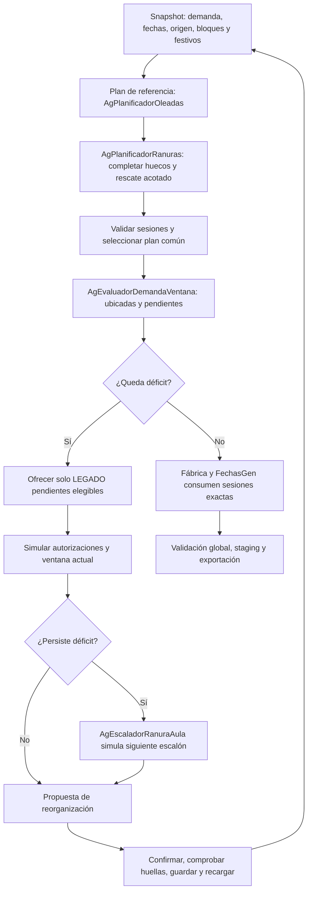

# Escalado automático de ranuras: plan consolidado

Fecha: 2026-11-14. Base inspeccionada: `753d404`, versión 1.6.4.14.
Estado: base implementada; planificación mixta y validación funcional pendientes. No certificable como 100 % cerrado.
Esta revisión no modifica código, ejecuta pruebas, compila, instala ni publica.

## 1. Documentos y alcance

Consolidación de:

- [Plan original](2026-11-12-escalado-automatico-tres-casos-implementacion.md): contrato funcional vigente.
- [Recuperación del planificador](2026-11-14-recuperacion-planificador-ranuras.md): recuperación técnica, no certificación funcional.
- [Reclasificación solo de pendientes](2026-11-14-reclasificacion-solo-pendientes-plan.md): autorización acotada y corrección del flujo UI.

Complementos actuales:

- [Diagnóstico y código propuesto para corrida #92](2026-11-14-corrida92-plan-y-codigo-propuesto.md): propuestas; no confundir con implementación.
- [Borrador de ejecución para corrida #92](../../.agents/plans/2026-11-14-corrida92-completar-huecos-plan.md): R-078, rondas 384–391, fases 1798–1805, según reserva local observada. No modificar ni duplicar esa reserva desde este documento.

Los estados iniciales «propuesto» o «sin pruebas» de los documentos históricos describen su fecha de creación. El estado consolidado procede del código actual y de la evidencia identificada aquí. Un cierre administrativo anterior no demuestra que la corrida #92 cumpla el contrato original.

## 2. Contrato preservado

| Inicio | Siguiente por confirmación | Ranuras semanales 4 h | Terminal |
|---|---|---|---|
| LUN-JUE | LUN-VIE | 4 → 5 | LUN-VIE |
| MAR-VIE | LUN-VIE | 4 → 5 | LUN-VIE |
| VIE-DOM | JUE-DOM; después MIE-DOM | 4 → 5 → 6 | MIE-DOM |
| VIE-SAB | JUE-SAB; después ISO `4,5,6,7` | 3 → 4 → 5 | ISO `4,5,6,7` |

- Un escalón inmediato por propuesta confirmada. VIE-DOM y VIE-SAB: máximo dos pasos desde su origen.
- Conservar la distinción histórica entre etiqueta `JUE-DOM` e ISO `4,5,6,7`: tienen iguales días, pero distinta continuidad en la escalera.
- Para 8 h: VIE-DOM/JUE-DOM/MIE-DOM tienen 3/4/5 ranuras semanales. Para 4 h, sábado admite mañana y tarde.
- Rotular MIE-DOM como `3,4,5,6M,6T,7` en 4 h y `3,4,5,6,7` en 8 h. `6M/6T` son rótulos; no persistirlos como días ISO.
- Mantener fechas de inicio y fin. El escalado agrega días semanales, no meses al calendario.
- Primero reorganizar AUTOMATICO en la ventana actual. Ofrecer escalón siguiente solo si persiste déficit y mejora el resultado fechado.
- FIJO conserva restricciones. LEGADO solo cambia con autorización específica. No reclasificar materias completas para resolver otras pendientes.
- Capacidad nominal no prueba factibilidad: descontar festivos, semanas parciales, bloques y demás restricciones efectivas.
- Una búsqueda agotada no demuestra imposibilidad matemática. Una fecha proyectada tampoco es una fecha mínima garantizada.

## 3. Verificación contra implementación

Rutas de servicios relativas a `ConversorPDF.XLL/Academic/Application/Services/Genetica/`.

| Plan original | Cambios actuales | Estado consolidado |
|---|---|---|
| F1736: contrato y reproducción | Escalera y pruebas de casos incorporadas; corrida real posterior vuelve a evidenciar déficit | Parcial: falta aceptación integral actual |
| F1737: origen de patrones | Migración V80; LEGADO/FIJO/AUTOMATICO y tratamiento diferenciado | Implementado; conservar auditoría de escritores y regeneración |
| F1738: planificación por ranuras | `AgPlanificadorRanuras`, sesiones fechadas, calendarios y búsqueda acotada recuperados | Parcial: asignación por bandas sigue desperdiciando huecos |
| F1739: evaluación compartida | Evaluador cuenta sesiones reales; escalador simula cambios | Parcial: generación y evaluación no seleccionan siempre el mismo plan |
| F1740: aplicación transaccional | Huellas de contenido/acción, comprobación previa, transacción, invalidación e idempotencia | Implementado; probar regresión tras nuevos cambios |
| F1741: UI y optimización | Evaluar antes del formulario; solo LEGADO pendientes y aulas elegibles; rechazo tipado | Implementado; no equivale a resolver planificación mixta |
| F1742: integración real | Pruebas añadidas; resultados históricos disponibles | Pendiente para #92 y ventana original |
| F1743: entrega | Full Debug histórico aprobado | Pendientes Full Release y smoke del resultado corregido |

### Recuperación conservada

- `AgSesionPlanificada`: asignatura, fecha y ranura concreta; listas de sesiones del plan.
- `AgHuellaPlanVentana`: contenido del contexto para invalidar caché y propuestas obsoletas.
- Fábrica: consumo de fechas del plan y protección de patrones no automáticos.
- `AgEscaladorVentanaAula` pasó a `AgEscaladorRanuraAula`. Usar nombre actual en código y documentación nueva.
- Evaluación diagnóstica puede proyectar fuera del plazo; no modificar por ello la ventana autorizada.

### Reclasificación conservada

- Solo aulas seleccionadas, identificadas y `Disponible`.
- Candidatos desde pendientes fechados por asignatura; excluye completos, FIJO y AUTOMATICO.
- Selección inicialmente desmarcada, asociada a identidad completa y diagnóstico sellado.
- Resultado tipado ante selección ajena, estado cambiado o configuración obsoleta; UI bloquea la ejecución si falla aplicar.
- `HuellaAccion` incluye `IdAula`; verificar antes de descartar acciones o declarar idempotencia.
- Guardado verifica contexto, perfil y SQL actuales; escritura atómica de aula/nodo activo/AA autorizadas, seguida de recarga e invalidación.

## 4. Fallos pendientes y corrección

### A. Evaluación y generación divergen

`AgPlanificadorOleadas.ConstruirInterno`, líneas 104–124: generación retorna referencia cuando hay patrones y exige siete días de adelanto para aceptar otro candidato.

**Causa:** un plan mixto LEGADO/AUTOMATICO puede aprobar una simulación pero no llegar al validador o a la fábrica. Una mejora válida menor de siete días se descarta.

**Corrección:** selector común, con idénticas entradas, restricciones y desempates. Quitar ambas condiciones. Validar alternativas antes de compararlas; conservar cobertura de materias previamente completas. Los resultados parciales sirven para diagnóstico, no para declarar generación completa.

### B. El buscador no aprovecha todos los huecos

`AgPlanificadorRanuras`: cursores por banda y asignación de una materia a una banda.

**Causa:** quedan fechas libres anteriores al cursor o en otra banda que una materia AUTOMATICO no aprovecha. Recuperar la clase no elimina esta restricción del algoritmo.

**Corrección:** ocupación por fecha/ranura. Conservar sesiones completas protegidas del plan de referencia; ubicar demanda pendiente restringida y después demanda libre en huecos elegibles. Permitir que una materia AUTOMATICO use varias bandas. Si el completado voraz falla, usar búsqueda acotada de rescate; informar agotamiento y déficit real.

### C. Fecha fija en el algoritmo

`AgPlanificadorRanuras`, líneas 77–78: `new DateTime(2027, 5, 30)` controla la salida anticipada.

**Causa:** comportamiento dependiente de un caso y año concretos; salida prematura en otras ventanas.

**Corrección:** usar `fechaFin` recibida y criterio explícito de parada. Completar dentro del límite satisface factibilidad, pero no demuestra fecha final óptima. Si se ofrece compactación, comparar candidatos sin declarar óptimo global.

### D. Diagnóstico aprobado no prueba resultado final

La corrida #92 requirió ampliar manualmente la ventana; el diagnóstico y el resultado exportado no justifican cerrar el contrato original. Los conflictos docentes globales pertenecen a otra capa y también deben impedir certificar una solución completa.

**Corrección:** comprobar el mismo plan hasta staging/exportación y separar métricas: capacidad local, sesiones materializadas y restricciones globales. Registrar ventana efectiva; `parametros_json` vacío no permite reconstruirla con seguridad.

## 5. Flujo objetivo

La selección de asignaturas autoriza una simulación; la confirmación final autoriza guardar. Sin mejora no se ofrece cambio vacío. Una solución parcial se informa como parcial y no autoriza silenciosamente una generación incompleta.

## 6. Trabajo restante, orden y entregables

Los identificadores C1–C8 son locales. Correspondencia con el borrador R-078; no crean nuevas fases.

### C1 — Reproducciones fieles · T1/F1798

- Congelar copias de datos de #92: CALI III-A/B, IV-A/B y CARTAGO X-A; registrar horas, patrones, fechas protegidas, bloques y todos los festivos efectivos.
- CALI III: 256 h/64 sesiones; IV: 272 h/68 sesiones, en unidades de 4 h. No sustituir demanda real por reparto igual entre materias.
- Ventana: 05/02/2027–30/05/2027. Preparar prueba que exponga divergencia entre `Construir` y `ConstruirEvaluacion`.
- Las fechas 13/05 y 19/05 obtenidas conservando determinadas sesiones son ejemplos de factibilidad local. No exigirlas como mínimos universales ni prometer disponibilidad docente con ellas.
- Salida: fixtures reproducibles y pruebas escritas. Ejecutarlas únicamente tras aprobación.

### C2 — Validador fechado común · T2/F1799

- Validar identidad y demanda, fechas dentro de límites, calendario/festivos, día/franja/duración, restricciones, duplicados y colisiones temporales reales.
- Verificar cantidades ubicadas, pendientes e infactibles consistentes; rechazar materias desconocidas o horas sobrantes.
- Respetar horas efectivas y unidad de sesión; no redondear silenciosamente demanda incompatible.
- Salida: contrato compartido para referencia, completado, búsqueda, evaluador y fábrica.

### C3 — Completar huecos · T3/F1800

- Implementar ocupación por sesión y `CompletarReferencia`, siguiendo el anexo de código propuesto, revisado contra firmas actuales.
- Mantener sesiones completas protegidas; respetar FIJO/LEGADO sin autorización. Respetar genes bloqueados cuando formen parte de las entradas efectivas.
- Rellenar huecos anteriores y alternar bandas para AUTOMATICO, sin exclusividad artificial por materia.
- Eliminar fecha fija; límites de búsqueda y cancelación explícitos. Preservar mejor solución válida al agotar presupuesto.
- No confundir igualdad de clave de ranura con ausencia de solapamiento: comprobar intervalos de bloques.
- Salida: plan fechado determinista; déficit y agotamiento explícitos.

### C4 — Selector único · T4/F1801

- Evaluar referencia, completado y rescate según necesidad; validar antes de elegir.
- Ordenar por completitud, cobertura real, materias pendientes, fecha final y clave estable. No empeorar materias antes completas para mejorar un total agregado.
- Suprimir `generacion_con_patrones` y umbral de siete días.
- Unificar filtros de demanda, horas, patrones, calendario y bloques entre evaluador, validador y fábrica; mismas entradas producen mismo plan completo.
- Comparar ventana actual y siguiente con el mismo selector. Exigir mejora fechada, no aumento nominal de ranuras.
- Salida: evaluación confirmada reproducible después de guardar y recargar.

### C5 — Consumo fiel · T5/F1802

- `AgFabricaIndividuo`, `FechasGen`, `AgCoherenciaGrupo` y expansor deben conservar fecha, día, franja y horas de cada sesión elegida.
- No reconstruir oleadas mediante otro reparto ni desplazar sesiones completas silenciosamente.
- Si un bloqueo o restricción global invalida el plan, rechazar o recalcular explícitamente, conservando límite y autorización.
- Salida: igualdad del plan elegido, genes, sesiones expandidas, staging y exportación; horas exactas y cero sesiones fuera del plazo en los casos factibles.

### C6 — Trazabilidad y persistencia · T6/F1803

- Guardar configuración efectiva reproducible en parámetros de corrida: ventana, aulas, demanda/patrones u origen verificable de su snapshot, bloques, festivos, versión y huella.
- INFO: identificador de corrida/aula, versión, ventana efectiva, plan elegido, ubicadas/pendientes y causa de rechazo. DEBUG: alternativas, presupuesto y detalle de ranuras. No depender de DEBUG activado para explicar un fallo básico.
- Comprobar que la huella cubre nuevas entradas del planificador y bloqueos efectivos; invalidar caché si cambia contenido aunque cantidades coincidan.
- Auditar escritores/importación/regeneración de AA: no sobrescribir FIJO/LEGADO ni reintroducir patrones en AUTOMATICO.
- Mantener limitación de perfiles compartidos: escribir el alcance autorizado y sincronizar/revalidar estado; no prometer aislamiento inexistente.
- Salida: reproducción y rechazo seguro de propuestas obsoletas sin escrituras parciales.

### C7 — Aceptación integral · T7/F1804

Preparar matriz y evidencia por caso:

1. LUN-JUE y MAR-VIE: calendario sintético sin festivos, demanda `5W`, escalado 4→5, consumo del día añadido, persistencia y segunda corrida sin propuesta.
2. VIE-DOM: demanda `5W` resuelta tras JUE-DOM; fixture independiente `6W` exige segunda confirmación hasta MIE-DOM. Terminal sin tercer paso.
3. VIE-SAB mantiene dos pasos y terminal ISO histórico. Comprobar rótulos y diferencias 4/8 h.
4. CALI III/IV: combinar patrones protegidos y última AUTOMATICO; completar dentro del 30/05/2027 sin exigir autorización para materias completas.
5. CARTAGO X-A y calendarios con semanas parciales/festivos: horas exactas, sábado M/T y ausencia de huecos desperdiciados que el completado pueda usar.
6. Probar mezcla FIJO/LEGADO/AUTOMATICO, materias completas protegidas, terminal con reorganización posible y mejora menor de siete días.
7. Cancelación, agotamiento, contexto inválido, aulas no disponibles, cambio de perfil, huella alterada, error SQL e idempotencia; sin cambios parciales ni avance del AG tras rechazo.
8. Misma cantidad y distinto contenido de festivos/bloques/patrones invalida caché. Probar otro año y otro límite.
9. Verificar paridad exacta hasta staging/exportación. Diagnóstico local favorable no elimina controles docentes R1/R7 ni otros HARD.

Salida: pruebas y checklist trazables al contrato original, no solo a métodos nuevos.

### C8 — Validación autorizada y cierre · T8/F1805

- Tras aprobación: Fast pertinente, Full Debug/x64 y Full Release/x64. Ejecución serial; preservar evidencias y código de salida.
- Smoke en copia de base/perfil con límite original, incluyendo los tres recorridos, rechazo, confirmación, recarga/reinicio e idempotencia.
- Repetir #92 desde snapshot anterior a la ampliación manual. Si no existe, declarar reconstrucción y sus diferencias; no presentar la ventana ampliada como reproducción original.
- Registrar versión/commit/configuración, comparativa antes/después, horas, pendientes, fecha final y conflictos HARD.
- No actualizar baseline para ocultar pérdidas de pruebas, exclusiones o fallos. Ajustarlo solo por cambios legítimos contabilizados.
- Sin publicación, instalación, commit o push implícitos.

## 7. Evidencia disponible y regla de cierre

Evidencia histórica: `_evidence/20261114-202146/summary.md` y TRX registran Full Debug con 1359/1359 aprobadas. Fast anteriores también aprobaron. No acreditan todavía la corrección pendiente del planificador mixto ni sustituyen Full Release y smoke del nuevo resultado.

Cierre exige simultáneamente:

- Rutas, persistencia e idempotencia correctas.
- Evaluación y generación materializan el mismo plan válido.
- Casos locales factibles completos dentro del plazo original.
- Restricciones globales aprobadas para declarar horario completo; déficit o conflictos restantes identificados sin garantía falsa.
- Gates y smoke del código final con evidencia reproducible.

**Decisión actual:** continuar C1–C7; todavía no certificar cierre ni pasar directamente a release. Ejecutar C8 únicamente con aprobación. No rehacer reclasificación y huellas ya implementadas; protegerlas con regresiones.
